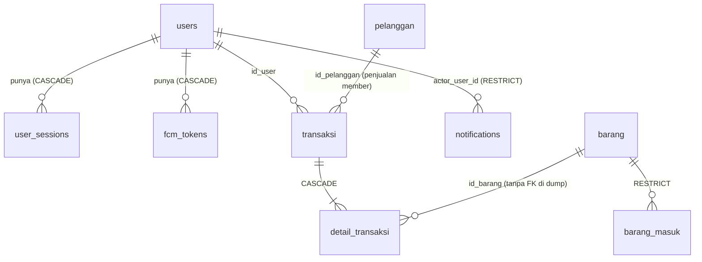

# be-pos-web-app — Ringkasan Backend

> Dokumentasi lengkap backend di `be-pos-web-app/`, disusun dengan membaca seluruh file sumber
> (88 file `.js`, ~4.900 baris), catatan skema DB (`struktur-tabel-field-now.txt`), dump DB Railway
> (`backup_dbfromrailway29sep26.sql`), dan cara frontend (`fe-pos-web-app/`) memanggil API.
>
> Snapshot: branch `main`, commit terakhir `81c3f7b` (2026-10-17). Semua yang tertulis di bawah menggambarkan kode **apa
> adanya**, termasuk bug-nya. Bagian 14 berisi daftar masalah yang ditemukan; satu di antaranya (rotasi refresh token)
> diverifikasi dengan menjalankan kode, sisanya berdasarkan pembacaan kode.

---

## Daftar isi

1. [Gambaran umum](#1-gambaran-umum)
2. [Tech stack](#2-tech-stack)
3. [Struktur proyek](#3-struktur-proyek)
4. [Cara menjalankan](#4-cara-menjalankan)
5. [Arsitektur](#5-arsitektur)
6. [Autentikasi & sesi](#6-autentikasi--sesi)
7. [Referensi API](#7-referensi-api)
8. [Aturan bisnis](#8-aturan-bisnis)
9. [Database](#9-database)
10. [Notifikasi, realtime, push & scheduler](#10-notifikasi-realtime-push--scheduler)
11. [Pembuatan PDF](#11-pembuatan-pdf)
12. [Konvensi & bentuk respons](#12-konvensi--bentuk-respons)
13. [Cara frontend memakai backend](#13-cara-frontend-memakai-backend)
14. [Temuan: bug, risiko, inkonsistensi](#14-temuan-bug-risiko-inkonsistensi)
15. [Kode mati dan legacy](#15-kode-mati-dan-legacy)
16. [Langkah selanjutnya yang disarankan](#16-langkah-selanjutnya-yang-disarankan)

---

## 1. Gambaran umum

REST API untuk **sistem point-of-sale (POS) toko kelontong kecil** ("Toko Kelontong Nuryati", Mojokerto — nama dan alamat
toko ditulis langsung (hard-coded) di controller unduh invoice). Kosakata domain memakai bahasa Indonesia:

| Istilah | Arti dalam sistem |
|---|---|
| `barang` | barang dagangan / item inventaris |
| `barang_masuk` | barang masuk (log restock) |
| `pelanggan` | pelanggan (member terdaftar) |
| `transaksi` / `detail_transaksi` | header penjualan / baris item penjualan |
| `kasir` | petugas kasir |
| `stok_dasar`, `satuan_dasar` | stok / satuan dalam *satuan dasar* item (PCS atau GRAM) |
| `harga_jual_per_sd`, `harga_modal_per_sd` | harga jual / harga modal **per satuan dasar** |
| `poin_loyalitas` | poin loyalitas pelanggan |
| `berhasil` / `pending` / `dibatalkan` | status transaksi: berhasil / menunggu / dibatalkan |

Ada tiga role pengguna: **`kasir`** (menjalankan penjualan dan mengelola pelanggan), **`admin`** (pengelola stok — menerima
barang, mengedit item) dan **`owner`** (dashboard baca-semua, laporan, notifikasi, push alert).

Backend berupa satu aplikasi Express 4 (ES modules) yang berbicara dengan PostgreSQL lewat `pg`, mengautentikasi dengan JWT di
**cookie httpOnly**, dengan push Firebase Cloud Messaging (FCM) + Server-Sent Events (SSE) untuk notifikasi owner.
Di-deploy di Railway (dump DB berasal dari Railway Postgres 18.6); frontend-nya SPA React/Vite di Vercel.

---

## 2. Tech stack

| Aspek | Pilihan |
|---|---|
| Runtime | Node.js (ESM — `"type": "module"`); mesin dev memakai v24.19.0 |
| Web framework | Express `^4.21.2` |
| DB | PostgreSQL via `Pool` dari `pg ^8.15` (SQL mentah, tanpa ORM, tanpa tool migrasi) |
| Auth | `jsonwebtoken` (HS256), `bcrypt ^6`, `cookie-parser` |
| Validasi | `joi ^17` (hanya dipakai di sebagian controller) |
| Rate limit | `express-rate-limit ^8.1` (hanya untuk login, store in-memory) |
| CORS | `cors` dengan allow-list dari env |
| Push | `firebase-admin ^14.2` (FCM `sendEachForMulticast`) |
| Realtime | SSE buatan sendiri (`res.write`) |
| Penjadwalan | `node-cron ^4.6` (saat ini **tidak dijalankan** — lihat §10.4) |
| PDF | `pdfkit` (invoice), `pdfkit-table` (laporan harian) |
| ID | `uuid` v4 (di DB juga ada default `gen_random_uuid()`) |
| Dev | `nodemon` (devDependency, tetapi justru dipakai sebagai perintah `npm start`) |

Belum ada: test, linter/formatter, TypeScript, Dockerfile/Procfile, konfigurasi CI, README backend, maupun
`package-lock.json` yang di-commit (file itu masuk `.gitignore`).

---

## 3. Struktur proyek

```text
be-pos-web-app/
├── package.json            # name "back-end-pa-app"; satu-satunya script: "start": "nodemon src/server.js"
├── .env.example
├── .gitignore              # node_modules/, secrets/, package-lock.json
└── src/
    ├── server.js           # entry: muat config → app → import firebase → listen
    ├── app.js              # membuat app Express, urutan middleware, pemasangan route
    ├── config/
    │   ├── config.js       # dotenv + semua env var dalam satu objek
    │   ├── firebase.js     # inisialisasi firebase-admin dari env FIREBASE_* satuan
    │   └── scheduler.js    # tampilan pengaturan cron di atas config
    ├── database/db.js      # pg Pool + log koneksi "SELECT NOW()" saat boot
    ├── middlewares/
    │   ├── auth.middleware.js     # authenticate (JWT) + authorize(roles)
    │   ├── cors.middleware.js
    │   └── sseAuth.middleware.js  # seluruhnya di-comment
    ├── routes/
    │   ├── auth/authRoutes.js         # publik: register, login
    │   ├── auth/roleAuthRoutes.js     # per-role: refresh, logout, users, sessions
    │   ├── role/roleRoutes.js         # createRoleRoutes() – menyusun router resource bersama
    │   ├── owner/ownerRoutes.js       # khusus owner: laporan, statistik
    │   ├── barang/ barangMasuk/ pelanggan/ transaksi/ fcm/   # masing-masing satu router
    │   └── notification.routes.js
    ├── controllers/            # satu file per handler, index.js me-re-export (lihat §5.4)
    │   ├── auth/  barang/  barangMasuk/  pelanggan/  transaksi/
    │   └── reports/  notifications/  fcm/
    ├── services/               # token.service.js (JWT), session.service.js (sesi refresh)
    ├── notifications/          # types, formatter, repository (SQL), service (orkestrasi), utils
    ├── fcm/                    # fcm.repository.js (SQL) + fcm.service.js (kirim via Firebase)
    ├── realtime/               # SSE: sse/manager.js (registri client), sse/controller.js, publisher.js
    ├── scheduler/              # report.scheduler.js (cron laporan harian) + index.js
    ├── utils/                  # cookieOptions, qtyFormat, generateInvoicePDF, generateDailyReportNotificationPDF
    ├── uploads/                # legacy: 15 gambar item + icon-store.svg (tidak ada yang menyajikannya)
    └── file-generate/invoices/ # legacy: 64 PDF invoice hasil generate lama yang ikut ter-commit ke git
```

Root repositori (`pos-web-app/`) juga berisi `fe-pos-web-app/`, `struktur-tabel-field-now.txt` (catatan skema UTF-16) dan
`backup_dbfromrailway29sep26.sql` (`pg_dump` **beserta data**, lihat §14).

---

## 4. Cara menjalankan

### 4.1 Perintah

```bash
cd be-pos-web-app
npm install
cp .env.example .env     # lalu isi (lihat di bawah)
npm start                # = nodemon src/server.js  (tidak ada script `node` biasa)
```

Port default: env `PORT`, jika kosong `5050` (di `.env.example` tertulis `5000`).

### 4.2 Urutan boot (`src/server.js`)

1. `import config` → menjalankan `dotenv.config()`.
2. `import app` → membangun app Express (ini juga meng-import `token.service.js`, yang **melempar error saat import** jika
   secret JWT tidak diset; dan `db.js`, yang membuka pool dan mencetak "Database connected successfully" / error-nya).
3. `import "./config/firebase.js"` → `initializeApp({ credential: cert(...) })`. **Server tidak bisa start tanpa kredensial
   Firebase yang valid**, dan `fcm.service.js` juga memanggil `getMessaging()` saat import.
4. `// startSchedulers();` **di-comment**, sehingga cron laporan harian tidak pernah jalan.
5. `app.listen(PORT)`.

### 4.3 Environment variable

| Variabel | Dipakai di | Default / catatan |
|---|---|---|
| `DB_HOST`, `DB_PORT`, `DB_USER`, `DB_PASSWORD`, `DB_NAME` | `db.js` via `config.db` | Contoh memakai DB `grocery_store`. Tidak ada dukungan SSL / `DATABASE_URL`. |
| `PORT` | `server.js` | fallback ke `5050` |
| `NODE_ENV` | opsi cookie, log startup | `production` mengubah default `Secure`/`SameSite` cookie |
| `JWT_ACCESS_SECRET`, `JWT_REFRESH_SECRET` | `token.service.js` | **wajib** (`JWT_SECRET` tunggal yang lama diterima sebagai fallback untuk keduanya) |
| `ACCESS_TOKEN_TTL` | detik | default kode `900`; contoh `120` |
| `REFRESH_TOKEN_TTL` | detik | default kode `604800` (7 hari); contoh `3600` |
| `COOKIE_NAME_AT` / `COOKIE_NAME_RT` | cookie auth | `access_token` / `refresh_token` |
| `COOKIE_DOMAIN` | `Domain` cookie | dihilangkan jika kosong |
| `COOKIE_SECURE`, `COOKIE_SAME_SITE` | flag cookie | lihat §6.4 untuk logika penentuannya |
| `CLIENT_ORIGINS` | allow-list CORS | origin **persis**, dipisah koma |
| `ENABLE_REPORT_SCHEDULER`, `REPORT_CRON`, `APP_TIMEZONE` | scheduler | scheduler saat ini tidak pernah dijalankan; contoh cron `*/5 * * * * *` = tiap 5 detik |
| `FIREBASE_PROJECT_TYPE`, `FIREBASE_PROJECT_ID`, `FIREBASE_PRIVATE_KEY_ID`, `FIREBASE_PRIVATE_KEY` (`\n` di-unescape), `FIREBASE_CLIENT_EMAIL`, `FIREBASE_CLIENT_ID`, `FIREBASE_AUTH_URI`, `FIREBASE_TOKEN_URI`, `FIREBASE_AUTH_PROVIDER_X509_CERT_URL`, `FIREBASE_CLIENT_X509_CERT_URL`, `FIREBASE_UNIVERSE_DOMAIN` | `config/firebase.js` | **Tidak satu pun ada di `.env.example`.** |
| `FCM_ANDROID_CHANNEL_ID` | `fcm.service.js` | default `owner_high_priority` |
| `BASE_URL`, `FIREBASE_SERVICE_ACCOUNT_PATH` | `config.js` | dibaca ke config tetapi **tidak pernah dipakai** (kemunculan `baseUrl` di dua controller auth adalah `req.baseUrl` milik Express) |

---

## 5. Arsitektur

### 5.1 Alur request (`src/app.js`)

```text
request
  → app.set("trust proxy", 1)                  # satu hop proxy (Railway)
  → logger debug  (method/url + SEMUA header + req.cookies)   # lihat §14 — mencatat token
  → corsMiddleware                              # allow-list, credentials: true
  → express.json()
  → cookieParser()                              # catatan: jalan SETELAH logger, jadi cookie yang tercatat = undefined
  → router
```

**Tidak ada** global error handler, handler 404, `helmet`, maupun pengaturan batas ukuran body selain default Express.

### 5.2 Pemasangan route

```js
app.use("/api/auth",  authRoutes);                                   // publik
app.use("/api/admin", roleAuthRoutes, adminRoleRoutes);              // createRoleRoutes()
app.use("/api/kasir", roleAuthRoutes, kasirRoleRoutes);              // createRoleRoutes()
app.use("/api/owner", roleAuthRoutes, ownerRoleRoutes, ownerRoutes); // createRoleRoutes({ includeNotifications, includeFcm }) + route khusus owner
```

Jadi **router resource yang sama** (`barang`, `barang-masuk`, `pelanggan`, `transaksi`) dipasang tiga kali, di
`/api/admin`, `/api/kasir` dan `/api/owner`. `notifications` dan `fcm-tokens` hanya ada di bawah `/api/owner`.

Konsekuensi penting:

* Prefix role di URL **bukan** pemeriksaan otorisasi. Otorisasi ditentukan per-route oleh
  `authorize([...])` terhadap `req.user.role` dari JWT. Token owner yang dikirim ke `/api/kasir/barang` tetap berhasil jika
  `owner` diizinkan di route tersebut.
* Yang sebenarnya mengikat sesi browser ke prefix-nya adalah **`Path` cookie**: saat login, cookie auth dikeluarkan
  dengan `Path=/api/<role>`, sehingga browser hanya mengirimnya ke prefix itu (§6.4). Client yang memakai header `Bearer` tidak
  terikat aturan ini.
* Pada route resource bersama (`barang`, `barang-masuk`, `pelanggan`, `transaksi`) `authenticate` berjalan **dua kali** per
  request — sekali di `createRoleRoutes` (`router.use("/barang", authenticate, …)`) dan sekali lagi di dalam tiap route. Verifikasi
  JWT murah, tetapi ini redundan.

### 5.3 Middleware autentikasi / otorisasi (`auth.middleware.js`)

* `authenticate`: token diambil dari `Authorization: Bearer <jwt>` lebih dulu, kalau tidak ada dari cookie `access_token`. Tanpa token → **401**
  `{ message: "Unauthorized" }`. Token tidak valid/kedaluwarsa → **403** `{ message: "Forbidden" }`. Jika berhasil, `req.user` =
  payload terdekode `{ id_user, role, username, iat, exp }`.
* `authorize(roles)`: `req.user.role` tidak ada di daftar → **403** `{ message: "Akses ditolak" }`.

> Pembedaan 401 vs 403 itu penting: frontend hanya me-refresh token pada **401** (§13). Ini hanya berfungsi karena
> cookie access token kedaluwarsa pada detik yang sama dengan JWT-nya, sehingga token kedaluwarsa tidak terkirim sama sekali (→ 401).

### 5.4 Konvensi tata letak kode

* **routes/** menghubungkan verb HTTP + middleware ke controller.
* **`controllers/<feature>/<action>.js`** — satu handler async yang di-export default per file; `index.js` me-re-export-nya.
  Controller berisi validasi Joi, SQL mentah lewat `pool` bersama, dan respons.
* **services/** (`token`, `session`) serta pasangan **repository/service** di `notifications/` dan `fcm/` menampung logika
  yang dipakai ulang. Di tempat lain tidak ada lapisan service/repository terpisah — controller query ke DB langsung.
* SQL selalu berparameter (`$1…`). SQL dinamis hanya menyisipkan nama kolom tetap atau placeholder `$n` hasil generate,
  sehingga input pengguna tidak pernah digabung ke dalam query.
* Transaksi DB dipakai untuk penulisan multi-statement (`BEGIN`/`COMMIT` pada client khusus): membuat penjualan, dan kedua
  alur barang masuk.

---

## 6. Autentikasi & sesi

### 6.1 Login — `POST /api/auth/login`

1. `loginLimiter`: **3 request / menit per `ip:username`** (in-memory; login yang berhasil juga dihitung). Melebihi batas →
   `429 { success:false, error:"RATE_LIMIT_EXCEEDED", retryAfter:60, message }`. Kuncinya memakai `ipKeyGenerator(req.ip)`
   (aman untuk IPv6), yang diperbaiki di commit `793eb13`.
2. Cari user berdasarkan `username`; user tidak ada → `401 USERNAME_NOT_FOUND`; password salah (`bcrypt.compare`) →
   `401 INVALID_PASSWORD` (dua pesan berbeda — memungkinkan enumerasi username).
3. Tanda tangani **access token** dan **refresh token** (keduanya HS256, payload `{ id_user, role, username }`, secret dan
   TTL berbeda).
4. Masukkan satu baris ke `user_sessions` (`refresh_hash = bcrypt(refreshJWT, cost 12)`, user-agent, IP, `expires_at`).
5. Set dua cookie, keduanya `httpOnly`, dengan `Path=/api/<role>`:
   * `access_token` = JWT, `expires` = sekarang + `ACCESS_TOKEN_TTL`
   * `refresh_token` = `"<session_id>.<refreshJWT>"`, `expires` = sekarang + `REFRESH_TOKEN_TTL`
6. Respons: `{ success, message:"Login berhasil", user:{ id_user, username, role } }` — **token tidak ada di body**.

### 6.2 Refresh — `POST /api/<role>/auth/refresh` (tanpa `authenticate`; memakai cookie refresh)

Urutan pemeriksaan: cookie ada → dipecah jadi `sessionId` + JWT → `verifyRefreshToken` → sesi ada →
`decoded.id_user === session.user_id` → `matchRefreshToken` (belum di-revoke, belum kedaluwarsa, bcrypt cocok) → user masih
ada. Setelah itu dikeluarkan access JWT **baru** dan refresh JWT **baru**, `rotateSession` menimpa `refresh_hash` dan
`expires_at` pada `session_id` yang *sama*, lalu kedua cookie di-set ulang. Jika gagal di tahap mana pun, cookie dihapus dan error
terstruktur dikembalikan:

```json
{ "success": false, "error": { "code": "SESSION_EXPIRED", "message": "...", "reason": "EXPIRED" } }
```

Kode: `MISSING_REFRESH_TOKEN`, `INVALID_REFRESH_FORMAT`, `INVALID_REFRESH_TOKEN`, `SESSION_NOT_FOUND`,
`REFRESH_SESSION_MISMATCH`, `REFRESH_NOT_FOUND`, `SESSION_REVOKED` (**403**), `SESSION_EXPIRED`, `REFRESH_MISMATCH`,
`USER_NOT_FOUND`, `ROTATE_FAILED` (500), `INTERNAL_ERROR` (500). `MISMATCH` dianggap sebagai pemakaian ulang token dan
me-revoke **semua** sesi user tersebut — tetapi lihat temuan 2 di §14.1: cabang ini sebenarnya tidak akan pernah tercapai.

### 6.3 Logout, sesi, user

* `POST /api/<role>/auth/logout` (semua role terautentikasi): me-revoke sesi yang tertulis di cookie refresh
  (`revoked_at = NOW()`), opsional menghapus `fcm_token` yang dikirim untuk user ini, dan menghapus kedua cookie memakai
  `Path=req.baseUrl`.
* `GET /api/<role>/auth/me/sessions` (owner): menampilkan sesi milik pemanggil.
* `DELETE /api/<role>/auth/me/sessions/:session_id` (owner): me-revoke sesi berdasarkan id (tanpa pengecekan kepemilikan — temuan 7 di §14.2).
* `GET /api/<role>/users` (owner, admin): `{ id_user, username, role }` untuk semua user.
* `PATCH /api/<role>/users/:id_user` (owner, admin): mengubah `username` dan/atau `password` user mana pun.
* `POST /api/auth/register` (**publik**): membuat user dengan `role` dari body — lihat temuan 1 di §14.1.

### 6.4 Opsi cookie (`utils/cookieOptions.js`)

`httpOnly: true` selalu. `Path` = `/api/<role>` (login/refresh) atau `req.baseUrl` (logout/penghapusan saat refresh gagal). `Domain` hanya
jika `COOKIE_DOMAIN` diset.

| `COOKIE_SAME_SITE` | `SameSite` yang dihasilkan |
|---|---|
| `none` / `strict` / `lax` | `None` / `Strict` / `Lax` |
| tidak diset | `None` di production, selain itu `Lax` |

| `COOKIE_SECURE` | `Secure` yang dihasilkan |
|---|---|
| `true` / `false` | sesuai nilainya |
| tidak diset | `true` jika SameSite `None`; selain itu `true` di production |

SPA lintas-situs (Vercel) ↔ API (Railway) karenanya memerlukan `NODE_ENV=production` (atau `none` + `true` secara eksplisit) dan
`CLIENT_ORIGINS` yang berisi origin Vercel secara persis.

---

## 7. Referensi API

Semua path di bawah relatif terhadap `/api/<role>` dengan `<role>` ∈ `admin | kasir | owner` (susunan route identik di tiap prefix;
otorisasi yang sebenarnya ada di kolom "Role"). Paginasi: `meta = { page, limit, total_data, total_page }`.

### 7.1 Publik (`/api/auth`)

| Method & path | Catatan |
|---|---|
| `POST /api/auth/register` | body `{ username, password, role }` — tanpa auth, tanpa pembatasan role, tanpa Joi. `bcrypt` cost 10. Mengembalikan 201 (field `data` selalu `undefined`: INSERT tidak memakai `RETURNING`). |
| `POST /api/auth/login` | body `{ username, password }`. Kena rate limit. Lihat §6.1. |

### 7.2 Auth / user (di setiap prefix role)

| Method & path | Role | Catatan |
|---|---|---|
| `POST /auth/refresh` | cookie | §6.2 |
| `POST /auth/logout` | semua yang terautentikasi | body boleh membawa `fcm_token` |
| `GET /users` | owner, admin | diurutkan berdasarkan username |
| `PATCH /users/:id_user` | owner, admin | body `{ username?, password? }`, minimal satu wajib ada |
| `GET /auth/me/sessions` | owner | |
| `DELETE /auth/me/sessions/:session_id` | owner | |

### 7.3 Barang (item) — `/barang`

| Method & path | Role | Perilaku |
|---|---|---|
| `GET /barang` | admin, kasir, owner | query `page=1`, `limit`, `keyword`. **Paginasi hanya jika `limit` diberikan**; kalau tidak, mengembalikan *semua* baris. `keyword` = `ILIKE` pada nama. Diurutkan `created_at DESC`. |
| `GET /barang/search?nama_barang=` | admin, kasir, owner | `ILIKE %…%`, diurutkan menurut nama, tanpa paginasi; `400` jika parameter kosong. |
| `GET /barang/:id_barang` | admin, kasir, owner | 404 jika tidak ada. |
| `PATCH /barang/:id_barang` | admin, owner | Joi, ≥1 field: `nama_barang` (≤100), `kategori_barang` (≤50), `stok_dasar` (int ≥0), `satuan_dasar` (`PCS`\|`GRAM`), `harga_jual_per_sd`, `harga_modal_per_sd` (≥0, 2 desimal). Cek nama duplikat tanpa membedakan huruf besar/kecil → 400. Mengembalikan baris lengkap hasil update. Ditambahkan di commit terakhir. |

Field item yang dikembalikan: `id_barang, nama_barang, stok_dasar, satuan_dasar, kategori_barang, harga_jual_per_sd, harga_modal_per_sd, created_at, updated_at`.
(`POST` dan `DELETE` untuk item di-comment; item baru dibuat lewat "new" pada barang masuk.)

### 7.4 Barang masuk (penerimaan barang / restock) — `/barang-masuk`

| Method & path | Role | Perilaku |
|---|---|---|
| `POST /barang-masuk/new` | admin | Joi: `nama_barang`, `stok_dasar` (int ≥1), `satuan_dasar`, `harga_jual_per_sd`, `harga_modal_per_sd` wajib; `kategori_barang` diterima tetapi **diabaikan**. Dalam satu transaksi DB: tolak nama duplikat (tidak peka huruf besar/kecil, `409 DUPLICATE_BARANG`), insert `barang`, insert `barang_masuk` (`harga_beli_total = stok × modal`). `201`. |
| `POST /barang-masuk/existing` | admin | Joi: `id_barang` (uuid), `qty_dasar` (int ≥1), `harga_beli_per_sd`. Dalam satu transaksi: insert `barang_masuk`; `stok_dasar += qty`; **jika harga beli berbeda dari modal saat ini, `harga_modal_per_sd` ditimpa dengan harga baru** (harga terakhir, bukan rata-rata). Mengembalikan `harga_modal_diperbarui`. |
| `GET /barang-masuk` | admin, owner | query `page=1`, `limit=10`, `keyword`, `from_date`, `to_date` (dibandingkan dengan `created_at`). Join ke `barang`. |
| `GET /barang-masuk/search?nama_barang=` | admin, owner | tanpa paginasi. |

### 7.5 Pelanggan — `/pelanggan`

| Method & path | Role | Perilaku |
|---|---|---|
| `POST /pelanggan` | kasir | Joi: `nama_pelanggan` (≤100, wajib), `no_hp` (hanya digit, ≤15, opsional; `""`→`null`). Nama dan nomor HP harus unik (pre-check + fallback `23505`) → 400. Mulai dari 0 poin/0 belanja/0 kunjungan. |
| `GET /pelanggan` | kasir, owner | `page`, `limit` (default 10; tidak valid → default), `keyword` pada nama atau no HP. Diurutkan menurut nama. |
| `GET /pelanggan/search?keyword=` | kasir, owner | filter sama, berpaginasi; `400 KEYWORD_REQUIRED` jika kosong. |
| `GET /pelanggan/:id_pelanggan` | kasir, owner | |
| `PATCH /pelanggan/:id_pelanggan` | kasir | `nama_pelanggan` dan/atau `no_hp` (keunikan dibandingkan pelanggan lain). Validasinya lebih longgar daripada saat create (tidak ada aturan hanya-digit). |

### 7.6 Transaksi (penjualan) — `/transaksi`

| Method & path | Role | Perilaku |
|---|---|---|
| `POST /transaksi` | kasir | Membuat penjualan — lihat §8.2. |
| `GET /transaksi` | kasir, owner | `page=1`, `limit=10`; terbaru lebih dulu; menyertakan `detail_barang[]` dan label `jumlah_item` (mis. `"2 pcs + 1.5 kg"`). Setiap kasir melihat semua penjualan. |
| `GET /transaksi/search?keyword=` (atau `kode_transaksi=` / `nama_pelanggan=`) | kasir, owner | mencocokkan `kode_transaksi` atau nama pelanggan **member** (`ILIKE`). Guest tidak bisa dicari lewat nama. |
| `GET /transaksi/:id_transaksi` | kasir, owner | header + `detail_barang[]` (satuan huruf besar di sini). |
| `GET /transaksi/stats/date-range` | owner | `startDate`, `endDate` (`YYYY-MM-DD`) → total harian untuk status `berhasil`, hari kosong diisi 0; default = 7 hari terakhir. (Juga dipasang di `ownerRoutes`.) |
| `GET /transaksi/:id_transaksi/invoice/download` | admin, kasir, owner | mengalirkan PDF struk yang dibuat saat diminta (§11). |
| `PATCH /transaksi/:id_transaksi` | kasir, admin | body `{ jumlah_bayar?, status_transaksi? }` — lihat temuan 16 di §14.3. |

### 7.7 Laporan (khusus owner) — di bawah `/api/owner`

| Path | Query | Mengembalikan |
|---|---|---|
| `GET /reports/weekly` | `startDate`, `endDate` | per hari `{ date_iso, total_transaksi_harian, total_harian }` (hari kosong diisi 0; default 7 hari terakhir). |
| `GET /reports/monthly` | `year`, `month` (default: sekarang) | `{ total_transaksi, total_pendapatan, total_hari_transaksi }`. |
| `GET /reports/yearly` | `year` (default: sekarang) | `{ summary:{ total_transaksi, total_pendapatan }, monthly:[{ bulan, total_transaksi, total_pendapatan, total_hari_transaksi, pendapatan_bulanan }] }`. |

Ketiganya hanya menghitung `status_transaksi = 'berhasil'`.

### 7.8 Notifikasi (khusus owner) — `/api/owner/notifications`

| Method & path | Perilaku |
|---|---|
| `GET /notifications?page=` | ukuran halaman tetap 10; menyertakan `meta.total_unread_notifications`. |
| `GET /notifications/unread` | semua yang belum dibaca; **mengembalikan 404** (dengan `data: []`) jika tidak ada. |
| `GET /notifications/:id_notification` | detail; untuk `REPORT_DAILY` ditambah `report_detail` (dari metadata tersimpan, atau dihitung ulang untuk tanggal tersebut). |
| `PATCH /notifications/read/:id_notification` | tandai satu notifikasi sudah dibaca. |
| `PATCH /notifications/read-all` | tandai semua notifikasi belum-dibaca sebagai dibaca (global). |
| `GET /notifications/stream` | stream **SSE** (§10.2). |
| `GET /notifications/:id_notification/download` | PDF notifikasi `REPORT_DAILY` (400 untuk tipe lain). |

Setiap notifikasi di respons mendapat `can_download_pdf` dan `download_pdf_endpoint`.

### 7.9 Token FCM (khusus owner) — `/api/owner/fcm-tokens`

| Method & path | Perilaku |
|---|---|
| `POST /fcm-tokens/register` | Joi `{ fcm_token (10–4096), device_info? }`. Upsert berdasarkan `fcm_token` — mendaftarkan ulang token memindahkannya ke user yang sedang login. |
| `DELETE /fcm-tokens/unregister` | body `{ fcm_token }`; hanya menghapus jika token itu milik pemanggil. |

---

## 8. Aturan bisnis

### 8.1 Satuan dan kuantitas

* Setiap item punya satu satuan dasar: `PCS` atau `GRAM` (constraint CHECK di DB). **Stok dan kuantitas disimpan sebagai bilangan
  bulat dalam satuan itu** (gram untuk barang timbangan). `harga_*_per_sd` adalah harga **per satu satuan dasar** (per gram atau per buah).
* Helper tampilan mengubah gram ≥ 1000 menjadi kg (`utils/qtyFormat.js`, `transaksiHelpers.js`, generator PDF).

### 8.2 Membuat penjualan (`POST /transaksi`, `addTransaksi.js`)

Body: `{ tipe_pelanggan: "guest"|"member", id_pelanggan?, items:[{ id_barang, quantity, subtotal? }], jumlah_bayar, id_user? }`.

Di dalam satu transaksi DB:

1. `SELECT … FROM barang WHERE id_barang = ANY($1) FOR UPDATE` — mengunci semua baris item terkait.
2. Untuk tiap baris: item harus ada (404); `quantity > 0`; `PCS` harus bilangan bulat; total per item yang berjalan tidak boleh melebihi
   `stok_dasar` (400 "Stok … tidak cukup"). Item yang sama boleh muncul di beberapa baris (kuantitasnya diakumulasi).
3. Subtotal baris: jika client mengirim `subtotal`, nilai itu **dipakai apa adanya**; jika tidak, server menghitung
   `harga_jual_per_sd × qty` dan, untuk item `GRAM`, **dibulatkan ke atas ke kelipatan Rp 500** berikutnya.
4. `total_harga = Σ subtotal`; tolak jika `jumlah_bayar < total_harga`; `kembalian = bayar − total`.
5. Identitas: `kode_transaksi = "TRX-" + 6 karakter hex terakhir dari UUID (huruf besar)`. Guest mendapat
   `nama_guest = "guest-<suffix yang sama>"` dan `id_pelanggan = NULL`. Status langsung diset `berhasil`.
6. Insert `transaksi`, insert massal `detail_transaksi` (menyimpan snapshot nama item dan harga satuan), dan kurangi stok dengan satu
   `UPDATE … FROM (VALUES …)`.
7. **Member**: `poin_loyalitas += floor(total / 10_000)`, `total_pembelian += total`, `frekuensi_transaksi += 1`.
8. `COMMIT`. Setelah itu, di luar transaksi, notifikasi `TRANSACTION_CREATED` dibuat dan di-push (§10). Jika itu
   gagal, penjualan tetap mengembalikan `201` dengan string `notification_error`.

Respons `201`: `{ success, message, data:{ id_transaksi, kode_transaksi, total_harga, jumlah_bayar, kembalian, nama_pelanggan, tipe_pelanggan, status_transaksi } }`.

### 8.3 Barang masuk

* **Item baru** (`/barang-masuk/new`): membuat item dengan `stok_dasar = qty` dan mencatat penerimaannya.
* **Item yang sudah ada** (`/barang-masuk/existing`): menambah stok; harga modal menjadi harga beli terakhir bila berbeda.
* Edit stok langsung lewat `PATCH /barang/:id` melewati log `barang_masuk` (perubahan tersebut tidak punya jejak audit).
* Penjualan lama menyimpan snapshot `nama_barang` / `harga_jual_per_sd` sendiri, sehingga perubahan harga atau nama kemudian tidak mengubah
  struk lama.

### 8.4 Siklus hidup penjualan

`status_transaksi ∈ {pending, berhasil, dibatalkan}` (CHECK di DB). API hanya membuat transaksi berstatus `berhasil`; ketiganya bisa
diset belakangan lewat `PATCH`. Laporan dan ringkasan harian hanya menghitung `berhasil`.

---

## 9. Database

PostgreSQL, 9 tabel, skema `public`; ekstensi `pgcrypto`, `uuid-ossp`, `pg_stat_statements`. **Tidak ada file
migrasi** di repo — skema hanya ada di dump dan di `struktur-tabel-field-now.txt`. Dua fungsi trigger
menjaga `updated_at` (`update_updated_at_column`, `update_detail_transaksi_timestamp`).

### 9.1 Relasi antar entitas



> `detail_transaksi.id_barang` ditandai sebagai FK di `struktur-tabel-field-now.txt` tetapi **constraint-nya
> tidak ada di dump** (hanya `detail_transaksi_id_transaksi_fkey`).

### 9.2 Tabel

**`users`** — `id_user` uuid PK · `username` varchar(50) UNIQUE · `password` text (bcrypt) · `role` varchar(20) CHECK salah satu dari
(`owner`,`admin`,`kasir`) · `created_at`, `updated_at`.

**`user_sessions`** — `session_id` uuid PK · `user_id` → users (CASCADE) · `refresh_hash` text · `user_agent` text ·
`ip_address` inet · `created_at` · `expires_at` · `revoked_at` (null = aktif). Index pada `user_id`.

**`barang`** — `id_barang` PK · `nama_barang` varchar(100) · `kategori_barang` varchar(50) · `stok_dasar` int ≥ 0 ·
`satuan_dasar` varchar(10) CHECK (`PCS`,`GRAM`) · `harga_modal_per_sd`, `harga_jual_per_sd` numeric(10,2) ·
`image_barang` varchar(255) (hanya ada di dump) · timestamp. Index: nama, `created_at DESC`. **Keunikan nama tidak
ditegakkan oleh DB** — hanya oleh pengecekan di aplikasi (tidak peka huruf besar/kecil).

**`barang_masuk`** — `id_barang_masuk` PK · `id_barang` → barang (UPDATE CASCADE, DELETE RESTRICT) · `qty_dasar` int > 0 ·
`harga_beli_per_sd`, `harga_beli_total` numeric(10,2) ≥ 0 · `created_at`. Index: `created_at DESC`, `id_barang`.

**`pelanggan`** — `id_pelanggan` PK · `nama_pelanggan` varchar(100) UNIQUE · `no_hp` varchar(15) UNIQUE (nullable) ·
`poin_loyalitas`, `total_pembelian`, `frekuensi_transaksi` int default 0 · timestamp.

**`transaksi`** — `id_transaksi` PK · `kode_transaksi` varchar(50) UNIQUE · `id_pelanggan` → pelanggan (nullable) ·
`tipe_pelanggan` varchar(15) · `nama_guest` varchar(50) · `id_user` → users · `total_harga`, `jumlah_bayar`, `kembalian`
**integer** (Rupiah) · `status_transaksi` varchar(20) CHECK (`pending`,`berhasil`,`dibatalkan`) · timestamp.
CHECK `transaksi_guest_rules`: baris `guest` harus punya `id_pelanggan IS NULL` dan `nama_guest IS NOT NULL`; baris `member`
sebaliknya. Index: `created_at DESC`, `date(created_at)`, `id_pelanggan`, `id_user`.

**`detail_transaksi`** — `id_detail_transaksi` PK · `id_transaksi` → transaksi (CASCADE) · `id_barang` uuid ·
`nama_barang` varchar(100) · `harga_jual_per_sd` numeric(10,2) · `quantity` int > 0 · `subtotal` int ≥ 0 · timestamp.
Index pada `id_barang`.

**`notifications`** — `id_notification` PK · `title` varchar(150) · `message` text · `notification_type` varchar(50) ·
`reference_table`, `reference_id` (penunjuk polimorfik, mis. `transaksi` + id) · `actor_user_id` → users (RESTRICT) ·
`is_read` bool default false · `metadata` jsonb (index GIN) · `created_at`. **Tidak ada kolom penerima** — semua
notifikasi dipakai bersama oleh seluruh owner.

**`fcm_tokens`** — `id_fcm_token` PK · `id_user` → users (CASCADE) · `fcm_token` text UNIQUE · `device_info` text · timestamp.

### 9.3 Snapshot data (dump Railway, 2026-09-29)

| Tabel | Baris | | Tabel | Baris |
|---|---|---|---|---|
| users | 3 (1 owner, 1 admin, 1 kasir) | | transaksi | 75 (53 guest + 22 member, semuanya `berhasil`) |
| barang | 16 (9 GRAM, 7 PCS) | | detail_transaksi | 94 |
| barang_masuk | 17 | | notifications | 76 |
| pelanggan | 8 | | fcm_tokens | 2 |
| user_sessions | **198** (3 user) | | | |

`notifications` menurut tipe: `REPORT_DAILY` 47 · `TRANSACTION_CREATED` 23 · `PRODUCT_UPDATED` 4 · `MEMBER_UPDATED` 2 (dua yang terakhir
sudah tidak ada di kode). Hanya 23 dari 75 penjualan yang punya notifikasi, artinya fitur notifikasi ditambahkan setelah sebagian besar
penjualan tercatat.

### 9.4 Perbedaan skema yang perlu diketahui

* Dump: `barang.kategori_barang` adalah **`NOT NULL` tanpa default**; `struktur-tabel-field-now.txt` menuliskannya sebagai nullable
  (default `NULL`) dan tidak punya `image_barang`. `POST /barang-masuk/new` tidak pernah meng-insert `kategori_barang`, sehingga hanya berfungsi
  pada skema yang lebih baru (nullable). Anggap dump itu **lebih lama** daripada production.
* Timestamp bertipe `timestamp without time zone` dengan default `CURRENT_TIMESTAMP` (zona waktu server/sesi, biasanya UTC di
  Railway) — lihat temuan 22 di §14.4.

---

## 10. Notifikasi, realtime, push & scheduler

### 10.1 Alur

```text
event (penjualan dibuat / laporan harian)
  → formatNotification()        # judul + pesan dalam bahasa Indonesia
  → createNotification()        # INSERT INTO notifications (+ metadata jsonb)
  → deliverNotification():
       ├─ publishNotification() # broadcast SSE ke semua client yang terhubung
       └─ sendOwnerPush()       # FCM ke setiap token milik role = 'owner' (fire-and-forget)
```

Tipe (`notification.types.js`): `TRANSACTION_CREATED`, `REPORT_DAILY`.

* **Transaksi dibuat**: judul "Transaksi Baru Dibuat", pesan
  `"<Kasir|Admin> <username> membuat transaksi TRX-XXXXXX sebesar Rp… atas nama "<name>"."`. Metadata =
  `{ id_transaksi, kode_transaksi, total_harga, tipe_pelanggan }` (respons API memformat ulang `total_harga` menjadi `"Rp…"`).
* **Laporan harian**: `sendDailyReport(date?)` menyimpan objek `metadata` `{ report_date, generated_at, summary:{ total_sales, total_transactions, total_member_transactions, total_guest_transactions }, highest_transaction, daily_items[] }`.

### 10.2 SSE (`realtime/`)

`GET /api/owner/notifications/stream` mengatur `text/event-stream`, mendaftarkan response ke `Map<userId, Set<res>>`
in-memory, mengirim `event: connected`, lalu `event: notification` dengan
`data: {"event":"notification","data":<baris notifikasi>}`. Pembersihan dilakukan pada `req.on("close")`. Keterbatasan: hanya single-process
(registri ada di memori), **tidak ada heartbeat/komentar keep-alive** (proxy bisa memutus koneksi yang idle), tidak ada replay `Last-Event-ID`,
dan autentikasi hanya diperiksa saat koneksi dibuka (stream bisa hidup lebih lama daripada access token).

### 10.3 Push FCM (`fcm/`)

`sendEachForMulticast` dalam batch 500, pesan `data`-only plus konfigurasi channel Android (`priority: high`, channel
`FCM_ANDROID_CHANNEL_ID`) dan web-push `Urgency: high`; title/body diduplikasi ke `data.notification_title/body` agar service
worker web bisa menampilkannya. Token yang gagal dengan `registration-token-not-registered`, `invalid-registration-token`
atau `invalid-argument` dihapus otomatis. Token juga dihapus saat logout (jika client mengirim `fcm_token`) dan lewat
`DELETE /fcm-tokens/unregister`.

### 10.4 Scheduler

`scheduler/report.scheduler.js` seharusnya menjalankan `sendDailyReport()` pada `REPORT_CRON` di `APP_TIMEZONE` (via `node-cron`), tetapi:
`startSchedulers()` di-comment di `server.js`, `ENABLE_REPORT_SCHEDULER` dibaca sebagai **string** mentah (jadi `"false"` bernilai
truthy), contoh cron-nya **tiap 5 detik**, tidak ada de-duplikasi per hari, dan tanggal laporan default dihitung dalam UTC
(`new Date().toISOString().split("T")[0]`). Dump menunjukkan scheduler ini *pernah* aktif: dari 76 notifikasi di dalamnya,
47 adalah `REPORT_DAILY` (jauh lebih banyak daripada jumlah hari aplikasi ini ada — sesuai dengan pengujian memakai cron
singkat), 23 adalah `TRANSACTION_CREATED`, dan 6 bertipe yang sudah tidak didefinisikan di kode (`PRODUCT_UPDATED` ×4,
`MEMBER_UPDATED` ×2).

---

## 11. Pembuatan PDF

* **Invoice** — `utils/generateInvoicePDF.js` (`pdfkit`): halaman bergaya struk thermal lebar 80 mm, tinggi 250 mm, header toko
  ("Toko Kelontong Nuryati", Ds. Beratwetan, Gedeg, Mojokerto — hard-coded di `downloadInvoicePdf.js`), tabel item
  (no, nama, qty, subtotal, `@ harga satuan`), total, dan kalimat terima kasih. Dibuat **saat diminta** di memori dan dikembalikan sebagai
  attachment `invoice-trx-<6 digit terakhir>.pdf`. (Versi lama menyimpan PDF ke disk — itulah 64 file di `src/file-generate/invoices/`.)
  **Bug:** beberapa baris header berisi teks contoh yang ditulis langsung (§14.4).
* **Laporan harian** — `utils/generateDailyReportNotificationPDF.js` (`pdfkit-table`, A4): tanggal, total penjualan/transaksi,
  transaksi tertinggi, dan tabel setiap item yang terjual hari itu beserta pelanggannya.

---

## 12. Konvensi & bentuk respons

* **Sukses**: `{ success: true, message, data, meta? }`.
* **Error** tidak seragam. Varian yang dipakai: `{ success:false, message }`; hanya `{ message }` (beberapa controller);
  login `{ success:false, message, error:"CODE" }`; refresh `{ success:false, error:{ code, message, reason? } }`;
  rate limit `{ success:false, message, error, retryAfter }`; barang masuk `{ …, errorCode }`.
* Banyak handler 500 mengirim `error: err.message` (teks error DB mentah) ke client.
* Status code: 400 untuk validasi / duplikat (juga dipakai di tempat yang seharusnya 409), 401 token tidak ada, 403 token salah atau role salah,
  404 tidak ditemukan, 409 hanya untuk nama item duplikat saat create, 429 pembatasan login, selebihnya 500.
* Pesan untuk pengguna memakai **bahasa Indonesia**.
* Uang berupa integer biasa (Rupiah) di `transaksi`/`detail_transaksi`, `numeric(10,2)` untuk harga satuan (dikembalikan oleh `pg`
  sebagai string).
* ID berupa UUID; `kode_transaksi` adalah kode yang mudah dibaca manusia.
* Penulisan huruf satuan berbeda antar endpoint: list/search transaksi mengembalikan `"pcs"`/`"gram"` (`transaksiHelpers.normalizeUnit`);
  `GET /transaksi/:id` mengembalikan `"PCS"`/`"GRAM"` (helper lokal sendiri).

---

## 13. Cara frontend memakai backend

(`fe-pos-web-app/`: React 19, Vite 7, axios, zustand, firebase, recharts, sweetalert2, plugin PWA; di-deploy di Vercel.)

* Satu instance axios per role (`/api/admin`, `/api/kasir`, `/api/owner`) dari `src/lib/http/axiosBase.js`, dengan
  `withCredentials: true`; origin API dari `VITE_API_ORIGIN`.
* Response interceptor: pada **401** (sekali per request) memanggil `POST <rolePath>/auth/refresh`, menggabungkan refresh yang
  bersamaan **di dalam satu tab**, lalu mengulang request; jika refresh mengembalikan 401/403 akan menampilkan "Sesi Anda Kadaluarsa" dan mengarahkan ke `/login`.
* Layar owner memakai `/reports/*`, `/transaksi/stats/date-range`, `/notifications*`, `/fcm-tokens/register|unregister`.
  Kasir memakai `/pelanggan*` dan `POST /transaksi`; admin memakai `/barang-masuk/new|existing` dan `/barang`.
* Service layer FE mendefinisikan pemanggilan yang **tidak punya route di backend**: `GET /barang-masuk/:id` (client admin/kasir/owner) dan
  `DELETE /barang-masuk/:id` (`shared/services/barangMasukService.js`).
* FE mencatat `document.cookie` dan detail request ke console pada setiap request.

---

## 14. Temuan: bug, risiko, inkonsistensi

Diurutkan kira-kira berdasarkan tingkat keparahan. "Terverifikasi" = direproduksi dengan menjalankan kode; selain itu berasal dari pembacaan source.

### 14.1 Keamanan — tinggi

1. **Siapa pun bisa membuat akun owner.** `POST /api/auth/register` bersifat publik dan memercayai `role` dari body
   (`registerUser.js`, route di `authRoutes.js:9`). FE tidak memakainya. → hapus, atau wajibkan auth `owner` dan
   validasi `role`.
2. **Rotasi refresh token dan deteksi pemakaian ulang tidak berfungsi (terverifikasi).** Refresh JWT (~237 byte) di-hash dengan
   bcrypt (`session.service.js:11,46`), dan bcrypt hanya membaca **72 byte pertama**. Untuk satu user, 72 byte itu
   sama di setiap token (header JWT + awal `{"id_user":"…`), sehingga token yang *sudah dirotasi* tetap cocok dengan hash *lama* —
   diuji dengan bcrypt 6.0.0: `compare(newToken, oldHash) === true`. Akibatnya: refresh token lama yang sudah dirotasi tetap
   valid sampai kedaluwarsa, dan cabang `MISMATCH → revoke all sessions` (`refreshToken.js:98`) tidak akan pernah tercapai. →
   hash SHA-256 dari token (atau simpan token acak opaque / `jti` per rotasi) sebagai gantinya.
3. **Admin bisa mengambil alih owner.** `PATCH /users/:id_user` mengizinkan `admin` mengubah username/password *user mana pun*,
   termasuk owner, tanpa pengecekan role; sesi juga tidak di-revoke setelah password diganti. Handler ini juga menjalankan
   `UPDATE` dua kali dan mengembalikan `RETURNING *`, yaitu **hash bcrypt ikut terkirim di respons** (`updateUser.js:36-51`).
4. **Rahasia tercatat di log.** `app.js:27-32` mencatat *semua* header request (`Authorization`, `Cookie` berisi kedua token) pada setiap
   request; `loginUser.js` mencatat pengaturan cookie. Hapus atau samarkan.
5. **Data asli ter-commit ke git.** `backup_dbfromrailway29sep26.sql` berisi hash password bcrypt, hash refresh sesi,
   token FCM, dan seluruh data penjualan; 64 invoice hasil generate dan 15 gambar upload juga ikut ter-commit. Jika repo ini atau akan menjadi
   publik/dibagikan, ganti kredensial dan bersihkan riwayat git.
6. **Celah yang bisa membuat proses crash (Express 4 + Node ≥ 15 = unhandled rejection mematikan proses).**
   * `logoutUser.js:9-10` — `revokeSession(sessionId)` dengan cookie refresh yang rusak (mis. `abc.def`) melempar error Postgres
     "invalid uuid" tanpa `try/catch`. User mana pun yang sudah login bisa memicunya dengan cookie buatan sendiri.
   * `sessionsUser.js` — kedua handler tanpa `try/catch` (UUID salah / error DB → crash).
   * `addBarangMasukBaru.js:22` dan `addBarangMasukExisting.js:19` memanggil `pool.connect()` *di luar* `try`.
   * `db.js` tidak punya handler `pool.on("error", …)` (error pada client idle setelah DB restart bersifat fatal).
   * Tidak ada global error middleware atau `process.on("unhandledRejection")`.
   → bungkus handler async (atau pakai `asyncHandler` kecil) dan tambahkan error middleware.

### 14.2 Keamanan — menengah / rendah

7. `DELETE /auth/me/sessions/:session_id` tidak memeriksa apakah sesi milik pemanggil (IDOR; dampak rendah dengan satu owner).
8. Login membocorkan apakah username ada (`USERNAME_NOT_FOUND` vs `INVALID_PASSWORD`). Limiter bersifat in-memory
   (reset saat restart, tidak dibagi antar instance) dan juga menghitung login yang *berhasil* (login ke-4 dalam semenit → 429).
9. `refreshToken.js` mengisi `WWW-Authenticate` dengan string literal `******'invalid_token'` (header tidak valid; kemungkinan hasil paste dari
   redaksi — seharusnya `Bearer error="invalid_token"`).
10. Penolakan CORS memanggil `cb(new Error(...))`, yang muncul sebagai error HTML 500, bukan 403 yang bersih; request tanpa
    header `Origin` selalu diizinkan (tidak masalah untuk client API, tetapi artinya CORS bukan batas keamanan).
11. Respons 500 membocorkan `err.message` (teks SQL, nama constraint).
12. Tidak ada `helmet`, tidak ada penyesuaian batas ukuran body, tidak ada kebijakan password / validasi username, tidak ada penguncian akun selain
    pembatasan login. Endpoint refresh/logout/PATCH-user tidak kena rate limit.
13. FE bergantung pada kedaluwarsa cookie == kedaluwarsa JWT agar mendapat 401 (refresh) dan bukan 403 (gagal permanen). Selisih jam atau client
    `Bearer` yang mengirim token kedaluwarsa akan mendapat 403 dan tidak pernah refresh.
14. Race multi-tab: dua tab me-refresh dengan cookie yang sama bersamaan adalah pola yang justru dihukum oleh deteksi pemakaian ulang
    (akan me-revoke semua sesi) — saat ini aman hanya karena temuan 2. Memperbaiki temuan 2 mengharuskan penanganan ini
    (mis. masa tenggang singkat untuk token sebelumnya).

### 14.3 Integritas data & logika bisnis

15. **`POST /transaksi` memercayai client.** `item.subtotal` menimpa harga hitungan server tanpa batas pengecekan
    (dibutuhkan untuk penjualan gram "beli gula Rp X", tetapi kasir bisa mengirim 0 atau nilai apa pun); `id_user` di body menimpa
    user yang terautentikasi, sehingga penjualan bisa dicatat atas nama orang lain; `tipe_pelanggan` tidak divalidasi menjadi
    `guest|member`; `id_pelanggan` yang hilang/asing atau `id_barang` non-UUID berakhir sebagai 500 generik setelah rollback. Endpoint ini
    sama sekali tidak punya skema Joi. `FOR UPDATE` multi-baris tanpa `ORDER BY` juga bisa deadlock saat konkurensi.
16. **Membatalkan penjualan tidak membatalkan efeknya.** `PATCH /transaksi/:id` bisa mengisi `status_transaksi` dengan string apa pun (tidak valid → 500
    dari CHECK) dan memindahkannya ke `dibatalkan` **tidak** mengembalikan stok maupun membalik poin loyalitas / `total_pembelian` /
    `frekuensi_transaksi`. Operasinya juga tidak transaksional, kasir/admin mana pun bisa mengedit penjualan mana pun, perbandingan `jumlah_bayar` memakai
    input yang tidak divalidasi, dan `admin` boleh PATCH penjualan padahal `admin` tidak bisa `GET`. Handler delete (yang sudah di-comment)
    dulu mengembalikan stok.
17. Stok bisa diedit langsung lewat `PATCH /barang/:id` (`stok_dasar`) tanpa catatan audit.
18. Harga modal = harga beli terakhir (tanpa rata-rata/FIFO), sehingga laporan margin berbasis `harga_modal_per_sd` hanya
    perkiraan untuk data historis.
19. `barang.nama_barang` tidak unik di DB; pengecekan duplikat berupa check-then-insert (rawan race) dan perubahan nama
    item tidak merambat ke `detail_transaksi` (snapshot memang disengaja).
20. `kategori_barang` diterima oleh validator "item baru" tetapi dibuang begitu saja.

### 14.4 Bug kebenaran fungsi

21. **PDF invoice mencetak data header palsu.** `generateInvoicePDF.js:110-114` menulis konstanta —
    `No Invoice : TRX-1A2B3C`, `Tanggal : 01 Januari 2025`, `Jam : 09:05`, `Pelanggan : guest-1A2B3C` — bukan
    `meta.kode_transaksi`, `meta.created_at`, `meta.nama_pelanggan`. `formatDate` dan field `meta` dihitung/dikirim tetapi
    tidak dipakai. Setiap struk yang diunduh menampilkan nomor invoice, tanggal, dan pelanggan yang sama.
22. **Batas hari mengikuti zona waktu DB, bukan zona waktu toko.** Laporan dan statistik harian memakai `date(created_at)` /
    `current_date` / `EXTRACT(…)` pada `timestamp without time zone`. Jika Postgres di Railway berjalan dalam UTC, "hari ini" berganti pada
    pukul 07:00 WIB. `APP_TIMEZONE` hanya dipakai oleh jadwal cron (yang nonaktif); `sendDailyReport` juga menentukan tanggal dalam UTC.
23. `to_date=YYYY-MM-DD` pada `getBarangMasuk` berarti tengah malam di awal hari itu (`<=`), sehingga baris pada tanggal akhir
    tidak ikut.
24. Input paginasi tidak divalidasi di `GET /transaksi`, `GET /barang-masuk`, `GET /barang` (`NaN` → 500) dan
    `limit` tidak punya batas atas; `GET /barang` tanpa `limit` mengembalikan seluruh tabel.
25. Laporan: `monthly`/`yearly` tidak melakukan cast pada count (`COUNT(DISTINCT …)` bertipe bigint → dikembalikan sebagai string; `bulan` dari
    `EXTRACT` bertipe numeric → string) sementara `weekly` melakukan cast ke `int`; `year`/`month` tidak divalidasi; baris yearly mengulang nilai yang sama
    pada `total_pendapatan` dan `pendapatan_bulanan`.
26. Validasi `PATCH /pelanggan` berbeda dari create (tanpa aturan hanya-digit; mengirim hanya `no_hp: ""` ditolak oleh pengecekan
    "minimal satu field", sehingga nomor HP tidak bisa dikosongkan sendirian).
27. `GET /notifications/unread` menjawab **404** saat kosong, yang bisa dianggap error oleh client.
28. `addTransaksi` melabeli aktor sebagai "Admin" atau "Kasir" padahal hanya `kasir` yang boleh memanggilnya (cabang mati). `notification_error`
    membocorkan teks error internal.

### 14.5 Operasional & kemudahan pemeliharaan

29. `.env.example` sudah usang: mendokumentasikan `FIREBASE_SERVICE_ACCOUNT_PATH` (tidak dipakai) tetapi tidak memuat 11 variabel `FIREBASE_*` yang
    dibutuhkan kode; `PORT` berbeda dari default kode; contoh cron menyala tiap 5 detik.
30. Sesi tidak pernah dibersihkan: 198 baris untuk 3 user (baris kedaluwarsa dan ter-revoke menumpuk, satu baris baru per login).
31. Notifikasi bersifat global (tanpa status baca per user, `read-all` berdampak ke semua orang) — cukup untuk satu owner, salah untuk beberapa owner.
32. `npm start` menjalankan **nodemon** (devDependency), `package-lock.json` di-gitignore (instalasi tidak reproducible), tidak ada
    endpoint health-check, tidak ada graceful shutdown, tidak ada logging terstruktur (hanya `console.log`, termasuk log CORS ber-emoji).
33. Tidak ada test, linting, formatting, migrasi, maupun dokumentasi API; bentuk respons/error dan huruf satuan tidak konsisten (§12).
34. `authenticate` dipasang secara redundan (dua kali) pada route resource bersama (§5.2).

### 14.6 Yang sudah baik

* SQL berparameter di mana-mana (tidak ditemukan injeksi); `LIMIT/OFFSET` memakai parameter terikat.
* Penulisan yang kritis terhadap uang memakai transaksi sungguhan dengan row lock (`FOR UPDATE`) dan update stok berbasis set (tanpa N+1).
* Pengaman di level DB: constraint CHECK (stok ≥ 0, satuan, status, konsistensi guest/member), FK, unique key, index yang membantu.
* Password di-hash dengan bcrypt; cookie auth `httpOnly`; secret access/refresh terpisah; tabel sesi dengan revoke/kedaluwarsa.
* Baris penjualan menyimpan snapshot nama + harga satuan, sehingga riwayat tetap utuh walau item diedit.
* Pengirim FCM membersihkan token mati dan mem-batch per 500; kegagalan push tidak pernah menghambat penjualan.

---

## 15. Kode mati dan legacy

* File yang di-comment seluruhnya: `controllers/barang/deleteBarang.js`, `controllers/pelanggan/deletePelanggan.js`,
  `controllers/transaksi/deleteTransaksi.js`, `middlewares/sseAuth.middleware.js`; route yang di-comment: `POST /barang`,
  `DELETE /barang/:id`, `DELETE /pelanggan/:id`, `DELETE /transaksi/:id`.
* Export default `roleRoutes` di `routes/role/roleRoutes.js` tidak dipakai; `getClient`/`clearClients` di `realtime/sse/manager.js` tidak dipakai.
* Konfigurasi yang tidak dipakai: `BASE_URL`, `FIREBASE_SERVICE_ACCOUNT_PATH`, `config.app.isDev`.
* `src/uploads/` (15 gambar, `icon-store.svg`) dan kolom `image_barang` — tidak ada lagi yang menyajikan atau menulis gambar (tanpa
  `express.static`, tanpa middleware upload).
* `src/file-generate/invoices/*.pdf` — 64 struk hasil generate dari sebelum invoice dibuat saat diminta.
* Pemanggilan `startSchedulers()` dan seluruh scheduler laporan harian (nonaktif).
* Tipe notifikasi `PRODUCT_UPDATED` / `MEMBER_UPDATED` ada sebagai baris di DB tetapi tidak punya formatter maupun konstanta di
  kode (jatuh ke formatter generik "Notifikasi" jika ditampilkan ulang).

---

## 16. Langkah selanjutnya yang disarankan

Dari yang paling bernilai:

1. Kunci atau hapus `POST /api/auth/register`; berhenti mengembalikan/membocorkan hash password; batasi siapa yang boleh mengedit owner.
2. Perbaiki penyimpanan refresh token (hash `sha256(token)` atau token acak opaque) dan putuskan cara menangani refresh yang bersamaan.
3. Hapus logger header/cookie; tambahkan middleware error-handling + pembungkus async; tangani `pool.on("error")`.
4. Perbaiki header invoice (pakai `meta.kode_transaksi`, `created_at`, `nama_pelanggan`).
5. Tambahkan validasi Joi pada `POST /transaksi`; berhenti menuruti `id_user` dari body; beri batas/validasi pada subtotal dari client.
6. Jadikan pembatalan bersifat transaksional dan kembalikan stok/poin; batasi transisi status yang diizinkan.
7. Tentukan zona waktu toko dan terapkan di SQL (`AT TIME ZONE 'Asia/Jakarta'`) atau simpan sebagai `timestamptz`.
8. Perbarui `.env.example`; tambahkan script start yang benar (`node src/server.js`), commit lockfile, tambahkan folder migrasi, dan
   keluarkan dump SQL / PDF hasil generate / uploads dari git.
9. Aktifkan (dan de-duplikasi) scheduler laporan harian setelah nilai cron dan parsing boolean diperbaiki.
10. Tambahkan test suite kecil untuk pembuatan penjualan, restock, dan alur auth/refresh.
